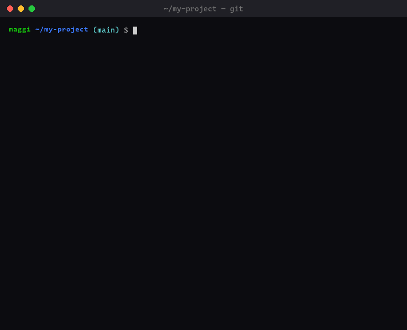
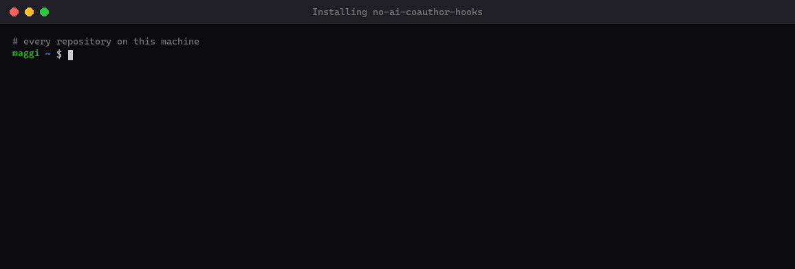

# no-ai-coauthor-hooks

Global git hooks that **stop AI assistants from crediting themselves as co-authors** in your commits.

Coding agents like Claude Code, GitHub Copilot or ChatGPT tend to append a trailer like this to every commit they make:

```
Co-Authored-By: <AI model name> <noreply@ai-vendor.example>
```

These hooks reject such commits and pushes in **every repository on your machine** (or just the ones you choose), and tell the agent to stop and ask you instead of working around it.



## Install



### Every repository on your machine

**Linux / macOS / Git Bash**

```bash
curl -fsSL https://raw.githubusercontent.com/N0tMaggi/no-ai-coauthor-hooks/main/install.sh | sh
```

**Windows (PowerShell)**

```powershell
irm https://raw.githubusercontent.com/N0tMaggi/no-ai-coauthor-hooks/main/install.ps1 | iex
```

This uses your existing global `core.hooksPath` (or creates `~/.git-hooks`), installs the two hooks there and sets `git config --global core.hooksPath`.

### Only the repository you're in

Run this inside the repository:

**Linux / macOS / Git Bash**

```bash
curl -fsSL https://raw.githubusercontent.com/N0tMaggi/no-ai-coauthor-hooks/main/install.sh | sh -s -- --local
```

**Windows (PowerShell)**

```powershell
& ([scriptblock]::Create((irm https://raw.githubusercontent.com/N0tMaggi/no-ai-coauthor-hooks/main/install.ps1))) -Local
```

This installs the hooks into the repository's own hooks folder. If you also have a global `core.hooksPath`, git would ignore that folder, so the installer then sets `core.hooksPath` for this repository only.

### Good to know

- Existing `commit-msg` / `pre-push` hooks are backed up first (`*.bak.<timestamp>`); running the installer again just updates the hooks.
- Prefer reading before running? Clone the repo and run `./install.sh [--local]` or `.\install.ps1 [-Local]`; they then use the local files instead of downloading them.

## What it does

| Hook | When | Effect |
| --- | --- | --- |
| `commit-msg` | `git commit` | Rejects the commit if the message has an AI `Co-Authored-By` trailer |
| `pre-push` | `git push` | Rejects the push if any commit being pushed has one, e.g. commits created without hooks or before the hooks were installed |

A trailer is blocked when the name or e-mail mentions one of: `claude`, `anthropic`, `opus`, `sonnet`, `haiku`, `chatgpt`, `openai`, `copilot`, `gemini`, `deepseek`, `qwen` (case-insensitive). Human co-authors are not affected.

When a hook blocks something, it prints instructions addressed to the AI agent: stop, don't try to bypass the hook, tell the user and ask how to proceed.

## Limitations

- Client-side hooks can always be skipped with `git commit --no-verify` / `git push --no-verify`. For a hard guarantee, add a server-side `pre-receive` hook on your git server.
- A global `core.hooksPath` replaces the per-repository `.git/hooks` folder, so repo-local hooks (e.g. from husky) stop running unless they also live in the global hooks folder.
- `pre-push` checks the whole history when you push a **new branch**, so a branch based on old commits that already contain an AI trailer can't be pushed.

## Uninstall

Global install:

```bash
git config --global --unset core.hooksPath
rm ~/.git-hooks/commit-msg ~/.git-hooks/pre-push
```

Single repository (run inside it):

```bash
git config --local --unset core.hooksPath
rm .git/hooks/commit-msg .git/hooks/pre-push
```

On Windows, run the same `git config` command and delete the two files in `%USERPROFILE%\.git-hooks` or `.git\hooks`.

## License

[MIT](LICENSE)
